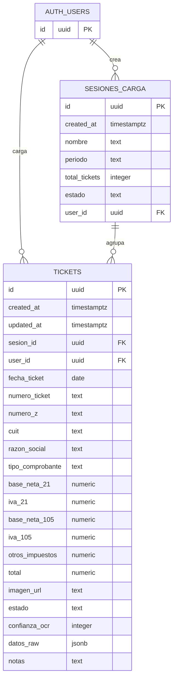

# TP Final Base de Datos - Tickets Z

## Sitio web

https://tickets-z.netlify.app/

Sistema web para registrar, procesar y consultar tickets fiscales argentinos tipo **Ticket Z**. El proyecto fue desarrollado como trabajo práctico final de la materia **Base de Datos**, con foco en el diseño del modelo relacional, definición de entidades, relaciones, claves primarias, claves foráneas y persistencia de datos en Supabase/PostgreSQL.

## Motivación del proyecto

El proyecto surgió de una necesidad real: mi tío contador tenía que cargar manualmente los datos de cientos de tickets fiscales cada mes en hojas de cálculo. Era un trabajo tedioso, repetitivo y propenso a errores que le quitaba horas de trabajo. La idea fue crear un sistema que automatizara este proceso mediante OCR/IA para extraer los datos de las fotos de tickets y almacenarlos directamente en una base de datos, permitiéndole ahorrar tiempo y evitar errores de transcripción.

## Objetivo

El objetivo del sistema es digitalizar la carga de tickets fiscales, extraer sus datos principales mediante OCR/IA y almacenarlos en una base de datos para su posterior consulta, edición, análisis y exportación.

Desde el punto de vista de Base de Datos, el trabajo busca demostrar:

- Diseño de un modelo entidad-relación.
- Implementación de tablas relacionales.
- Uso de claves primarias y foráneas.
- Relación entre usuarios, sesiones de carga y tickets.
- Persistencia de datos fiscales estructurados.
- Consultas para obtener métricas y listados.
- Separación entre datos procesados y datos crudos obtenidos por OCR.

## Descripción del sistema

La aplicación permite cargar imágenes o PDFs de tickets fiscales. Luego, el sistema procesa el archivo con OCR, extrae información relevante y guarda el resultado en la base de datos.

Cada ticket puede pertenecer a una sesión de carga. Una sesión agrupa varios tickets subidos en un mismo período o lote de trabajo.

## Entidades principales

### Usuarios

Representa a los usuarios del sistema. En Supabase se utiliza la tabla interna `auth.users`, que permite asociar cada sesión y cada ticket a un usuario.

### Sesiones de carga

Representa un lote o grupo de tickets cargados en una misma operación. Sirve para organizar los comprobantes por período, fecha o tanda de procesamiento.

### Tickets

Representa cada comprobante fiscal procesado. Contiene los datos extraídos del Ticket Z, como CUIT, razón social, fecha, número de ticket, importes de IVA, total y estado de procesamiento.

## DER



## Modelo relacional

```sql
auth.users(
  id PK
)

sesiones_carga(
  id PK,
  created_at,
  nombre,
  periodo,
  total_tickets,
  estado,
  user_id FK -> auth.users(id)
)

tickets(
  id PK,
  created_at,
  updated_at,
  sesion_id FK -> sesiones_carga(id),
  user_id FK -> auth.users(id),
  fecha_ticket,
  numero_ticket,
  numero_z,
  cuit,
  razon_social,
  tipo_comprobante,
  base_neta_21,
  iva_21,
  base_neta_105,
  iva_105,
  otros_impuestos,
  total,
  imagen_url,
  estado,
  confianza_ocr,
  datos_raw,
  notas
)
```

## Relaciones

- Un usuario puede crear muchas sesiones de carga.
- Una sesión de carga pertenece a un usuario.
- Un usuario puede cargar muchos tickets.
- Un ticket pertenece a un usuario.
- Una sesión de carga puede agrupar muchos tickets.
- Un ticket puede pertenecer a una sesión de carga.
- Si una sesión se elimina, los tickets asociados conservan sus datos y el campo `sesion_id` queda en `NULL`.
- Si un usuario se elimina, se eliminan sus sesiones y tickets asociados.

## Diccionario de datos

### Tabla `sesiones_carga`

| Campo | Tipo | Clave | Descripción |
|---|---|---|---|
| `id` | `uuid` | PK | Identificador único de la sesión |
| `created_at` | `timestamptz` | | Fecha de creación |
| `nombre` | `text` | | Nombre descriptivo de la sesión |
| `periodo` | `text` | | Período fiscal o mes asociado |
| `total_tickets` | `integer` | | Cantidad de tickets de la sesión |
| `estado` | `text` | | Estado general de la sesión |
| `user_id` | `uuid` | FK | Usuario propietario de la sesión |

### Tabla `tickets`

| Campo | Tipo | Clave | Descripción |
|---|---|---|---|
| `id` | `uuid` | PK | Identificador único del ticket |
| `created_at` | `timestamptz` | | Fecha de creación del registro |
| `updated_at` | `timestamptz` | | Fecha de última actualización |
| `sesion_id` | `uuid` | FK | Sesión de carga asociada |
| `user_id` | `uuid` | FK | Usuario propietario del ticket |
| `fecha_ticket` | `date` | | Fecha fiscal del comprobante |
| `numero_ticket` | `text` | | Número del ticket |
| `numero_z` | `text` | | Número de cierre Z |
| `cuit` | `text` | | CUIT del comercio |
| `razon_social` | `text` | | Razón social del comercio |
| `tipo_comprobante` | `text` | | Tipo de comprobante |
| `base_neta_21` | `numeric(12,2)` | | Base imponible al 21% |
| `iva_21` | `numeric(12,2)` | | IVA al 21% |
| `base_neta_105` | `numeric(12,2)` | | Base imponible al 10.5% |
| `iva_105` | `numeric(12,2)` | | IVA al 10.5% |
| `otros_impuestos` | `numeric(12,2)` | | Otros impuestos incluidos |
| `total` | `numeric(12,2)` | | Total del comprobante |
| `imagen_url` | `text` | | URL del archivo original |
| `estado` | `text` | | Estado del procesamiento |
| `confianza_ocr` | `integer` | | Porcentaje de confianza del OCR |
| `datos_raw` | `jsonb` | | Datos crudos devueltos por OCR/IA |
| `notas` | `text` | | Observaciones manuales |

## Reglas de negocio

- Cada ticket debe tener un identificador único.
- Los importes monetarios se guardan con dos decimales.
- El estado inicial de un ticket es `pendiente`.
- Los estados posibles del ticket son `pendiente`, `procesado`, `error` y `revisado`.
- Un ticket puede existir sin sesión asociada, pero debe conservar sus datos fiscales.
- El campo `datos_raw` permite guardar información no estructurada devuelta por el OCR sin modificar el modelo principal.
- La confianza del OCR se almacena como número entero entre 0 y 100.

## Normalización

El modelo separa los datos en entidades principales para evitar duplicación innecesaria:

- Los datos de autenticación se mantienen en `auth.users`.
- Las cargas masivas se agrupan en `sesiones_carga`.
- Los comprobantes individuales se almacenan en `tickets`.

La relación entre `sesiones_carga` y `tickets` evita repetir información del lote en cada ticket. Además, el uso de claves foráneas mantiene la integridad referencial entre las tablas.

## Consultas SQL de ejemplo

### Obtener todos los tickets procesados

```sql
SELECT *
FROM tickets
WHERE estado = 'procesado';
```

### Calcular el total facturado por CUIT

```sql
SELECT
  cuit,
  razon_social,
  SUM(total) AS total_facturado
FROM tickets
GROUP BY cuit, razon_social
ORDER BY total_facturado DESC;
```

### Obtener tickets por período

```sql
SELECT
  t.id,
  t.fecha_ticket,
  t.numero_ticket,
  t.razon_social,
  t.total,
  s.periodo
FROM tickets t
LEFT JOIN sesiones_carga s ON s.id = t.sesion_id
WHERE s.periodo = '2026-05';
```

### Contar tickets por estado

```sql
SELECT
  estado,
  COUNT(*) AS cantidad
FROM tickets
GROUP BY estado;
```

### Sumar IVA por alícuota

```sql
SELECT
  SUM(iva_21) AS total_iva_21,
  SUM(iva_105) AS total_iva_105
FROM tickets;
```

## Implementación de la base de datos

La base de datos se implementa con **Supabase**, que utiliza **PostgreSQL** como motor relacional.

Las migraciones se encuentran en:

- `supabase/migrations/20260517154700_create_tickets_z_schema.sql`
- `supabase/migrations/20260528130000_allow_public_tickets_access.sql`

La primera migración crea las tablas, claves primarias, claves foráneas, políticas de seguridad e índices. La segunda deshabilita temporalmente RLS para facilitar pruebas durante el desarrollo.

## Índices

Se definieron índices para mejorar consultas frecuentes:

```sql
CREATE INDEX IF NOT EXISTS idx_tickets_user_id ON tickets(user_id);
CREATE INDEX IF NOT EXISTS idx_tickets_fecha ON tickets(fecha_ticket);
CREATE INDEX IF NOT EXISTS idx_tickets_estado ON tickets(estado);
CREATE INDEX IF NOT EXISTS idx_tickets_sesion ON tickets(sesion_id);
```

Estos índices ayudan a optimizar búsquedas por usuario, fecha, estado y sesión.

## Stack técnico

- React 18
- Vite 5
- TypeScript 5
- Tailwind CSS 3
- Supabase/PostgreSQL
- Supabase Edge Functions
- Supabase Storage
- Anthropic Claude para OCR, si está configurado
- `xlsx` para exportación a Excel

## Funcionalidades

- Carga de tickets mediante drag and drop o selector de archivos.
- Soporte para imágenes y PDFs.
- Procesamiento OCR de tickets con IA.
- Registro de tickets en la base de datos.
- Dashboard con métricas generales.
- Listado de tickets con búsqueda, filtros y edición.
- Exportación de datos a Excel.

## Cómo ejecutar el proyecto

1. Instalar dependencias:

```bash
npm install
```

2. Configurar variables de entorno:

```bash
VITE_SUPABASE_URL=<url_del_proyecto_supabase>
VITE_SUPABASE_ANON_KEY=<anon_key_de_supabase>
ANTHROPIC_API_KEY=<api_key_opcional_para_ocr>
```

3. Crear el bucket de Storage:

```bash
supabase storage create-bucket tickets-uploads --public
```

4. Ejecutar en modo desarrollo:

```bash
npm run dev
```

5. Opcionalmente, servir la función OCR localmente:

```bash
supabase functions serve ocr-ticket
```

## Comandos disponibles

- `npm run dev`: iniciar servidor de desarrollo.
- `npm run build`: crear build de producción.
- `npm run preview`: previsualizar el build.
- `npm run lint`: ejecutar ESLint.
- `npm run typecheck`: ejecutar TypeScript sin generar archivos.

## Estructura relevante

- `src/App.tsx`: navegación principal.
- `src/pages/Upload.tsx`: carga de archivos y flujo OCR.
- `src/pages/Tickets.tsx`: listado, filtros, edición y exportación.
- `src/pages/Dashboard.tsx`: métricas y resumen.
- `src/lib/supabase.ts`: cliente Supabase.
- `src/lib/types.ts`: tipos de datos del modelo.
- `src/lib/exportExcel.ts`: exportación a Excel.
- `supabase/functions/ocr-ticket/index.ts`: función backend para OCR.
- `supabase/migrations`: scripts SQL de creación y configuración de la base de datos.

## Conclusión

El proyecto integra una aplicación web con una base de datos relacional en PostgreSQL. El modelo permite organizar tickets fiscales por usuario y sesión de carga, manteniendo integridad referencial y facilitando consultas para análisis contable.

Como TP final de Base de Datos, el sistema demuestra el diseño, implementación y uso práctico de un modelo relacional aplicado a un caso real de gestión de comprobantes fiscales.
